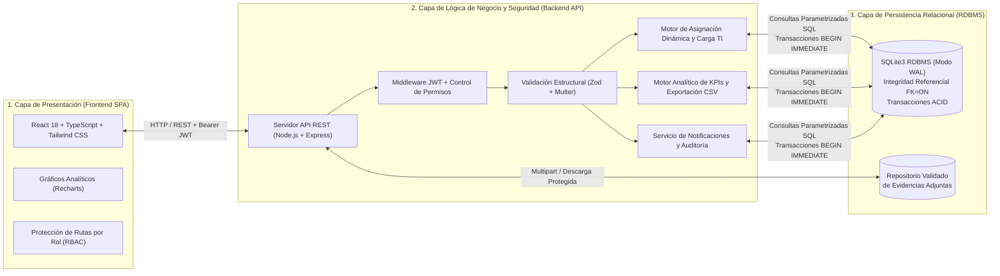
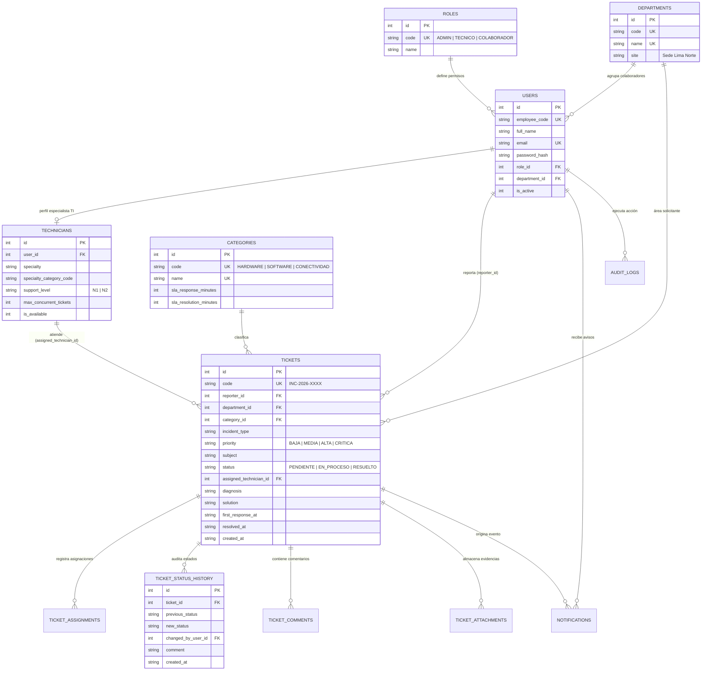

# Documentación Técnica de Arquitectura, Base de Datos y API REST

**Proyecto Académico:** Sistema web para la optimización de la gestión y seguimiento de incidencias en el área de Soporte TI  
**Organización:** KONECTAR BPO S.A.C. — Sede Lima Norte (RUC N.° 20609998947)  
**Área:** Soporte TI / Área de Sistemas  

---

## 1. Arquitectura del Sistema (Enfoque Multicapa / 3-Tier)

El sistema implementa una arquitectura web modular distribuida en **tres capas lógicas desacopladas** comunicadas mediante el protocolo **HTTP/REST** con carga útil JSON y sesiones firmadas con **JWT**, alineada con el marco teórico del proyecto:



### Decisiones Técnicas Fundamentadas
1. **Concurrencia sin corrupción de registros:** A diferencia del libro compartido con macros VBA descartado en 2024 por sobrescritura concurrente, la capa de datos opera sobre un motor relacional transaccional en modo **Write-Ahead Logging (`PRAGMA journal_mode = WAL`)** y transacciones atómicas `BEGIN IMMEDIATE`, garantizando propiedades **ACID** y generación correlativa sin colisiones (`INC-YYYY-NNNN`).
2. **Integridad Referencial Estricta:** Se activa `PRAGMA foreign_keys = ON` en cada conexión, aplicando restricciones `ON DELETE RESTRICT`, `ON DELETE CASCADE`, `UNIQUE` y `CHECK` directamente en el motor SQL.
3. **Delimitación del Alcance:** En coherencia con la definición del problema del informe (Sede Lima Norte), el sistema excluye módulos de facturación, planillas de RRHH e interfaces para clientes externos.

---

## 2. Modelo Entidad-Relación (Base de Datos Normalizada en 3FN)

El esquema relacional consta de **14 tablas normalizadas** ubicadas en `backend/src/database/schema.sql`:



### Diccionario Resumido de Tablas
| N.° | Tabla | Propósito Operativo | Claves y Restricciones Principales |
|---|---|---|---|
| 1 | `roles` | Perfiles RBAC (`ADMIN`, `TECNICO`, `COLABORADOR`) | `PK(id)`, `UNIQUE(code)` |
| 2 | `departments` | Áreas reales de KONECTAR BPO S.A.C. (Ventas, Backdata, Validación, Seguimiento, etc.) | `PK(id)`, `UNIQUE(code, name)` |
| 3 | `users` | Cuentas corporativas con hash seguro `bcrypt` | `PK(id)`, `FK(role_id, department_id)`, `UNIQUE(email, employee_code)` |
| 4 | `technicians` | Especialidad, nivel (`N1`/`N2`), capacidad máxima y disponibilidad | `PK(id)`, `UNIQUE FK(user_id)` |
| 5 | `categories` | Las 3 categorías del alcance (`Hardware`, `Software`, `Conectividad y redes`) y metas SLA | `PK(id)`, `UNIQUE(code)` |
| 6 | `ticket_sequences` | Contador anual transaccional para códigos correlativos únicos | `PK(year)` |
| 7 | `tickets` | Entidad central de incidencias con sellos de tiempo para KPI 1 y KPI 2 | `PK(id)`, `UNIQUE(code)`, `FK(reporter_id, department_id, category_id, assigned_technician_id)` |
| 8 | `ticket_assignments` | Trazabilidad de asignaciones automáticas, manuales y reasignaciones | `PK(id)`, `FK(ticket_id, technician_id, previous_technician_id)` |
| 9 | `ticket_status_history` | Historial **inmutable** de cambios de estado (`PENDIENTE`, `EN_PROCESO`, `RESUELTO`) | `PK(id)`, `FK(ticket_id, changed_by_user_id)` |
| 10 | `ticket_comments` | Conversación operativa y notas técnicas internas (`is_internal`) | `PK(id)`, `FK(ticket_id, user_id)` |
| 11 | `ticket_attachments` | Metadatos validados de capturas, PDFs y logs adjuntos | `PK(id)`, `UNIQUE(stored_name)`, `FK(ticket_id, uploaded_by_user_id)` |
| 12 | `notifications` | Centro de avisos automáticos vinculados a eventos reales de tickets | `PK(id)`, `FK(user_id, ticket_id)` |
| 13 | `system_settings` | Parámetros configurables (ej. activación y estrategia de auto-asignación) | `PK(key)` |
| 14 | `audit_logs` | Bitácora de auditoría y seguridad de acciones críticas | `PK(id)`, `FK(user_id)` |

---

## 3. Fórmulas e Implementación de Indicadores KPI

### KPI 1: Tiempo de Primera Respuesta
$$\text{Tiempo de Primera Respuesta} = \text{Fecha y hora de primera respuesta} - \text{Fecha y hora de registro}$$

- **Captura automática:** El campo `first_response_at` se sella automáticamente en la base de datos en el instante exacto en que un técnico (o administrador) documenta la primera atención sobre el ticket (paso a `EN_PROCESO`, resolución en primer contacto o primer comentario técnico público) y permanece inmutable.
- **Cálculo SQL (en minutos exactos):**
  ```sql
  ROUND(AVG((julianday(first_response_at) - julianday(created_at)) * 1440.0), 2)
  ```

### KPI 2: Tasa de Resolución
$$\text{Tasa de Resolución (\%)} = \left(\frac{\text{Incidencias resueltas}}{\text{Total de incidencias registradas}}\right) \times 100$$

- **Cálculo dinámico:** Se procesa en tiempo real sobre el conjunto filtrado por fecha, período, técnico, categoría o estado en `GET /api/reports/kpis` y `GET /api/dashboard`.

---

## 4. Catálogo Completo de Endpoints de la API REST

Prefijo base: `/api`

| Módulo | Método | Endpoint | Roles Autorizados | Descripción |
|---|---|---|---|---|
| Salud | `GET` | `/api/health` | Público | Estado operativo del servidor API |
| Auth | `POST` | `/api/auth/login` | Público | Autenticación corporativa y emisión de JWT |
| Auth | `POST` | `/api/auth/logout` | Autenticado | Cierre de sesión con registro en auditoría |
| Auth | `GET` | `/api/auth/me` | Autenticado | Perfil actual y contador de notificaciones |
| Auth | `PATCH` | `/api/auth/password` | Autenticado | Cambio seguro de contraseña verificando la actual |
| Auth | `PATCH` | `/api/auth/profile` | Autenticado | Actualización de datos de contacto propios |
| Catálogos | `GET` | `/api/catalogs` | Autenticado | Roles, departamentos y categorías activas |
| Categorías | `GET` | `/api/categories` | Autenticado | Listado de categorías y metas SLA |
| Categorías | `PUT` | `/api/categories/:id` | `ADMIN` | Edición de tiempos SLA por categoría |
| Usuarios | `GET` | `/api/users` | `ADMIN` | Listado filtrable de usuarios y técnicos |
| Usuarios | `POST` | `/api/users` | `ADMIN` | Creación transaccional de usuario / técnico |
| Usuarios | `PUT` | `/api/users/:id` | `ADMIN` | Edición integral de usuario y perfil técnico |
| Usuarios | `PATCH` | `/api/users/:id/status` | `ADMIN` | Activación o desactivación de cuenta |
| Técnicos | `GET` | `/api/technicians` | `ADMIN`, `TECNICO` | Carga laboral activa, disponibilidad y métricas |
| Técnicos | `PATCH` | `/api/technicians/:id/availability` | `ADMIN`, `TECNICO` | Cambio de disponibilidad operativa |
| Tickets | `GET` | `/api/tickets` | Autenticado (RBAC) | Listado paginado y filtrado según rol |
| Tickets | `POST` | `/api/tickets` | Autenticado | Registro de ticket + adjuntos + auto-asignación |
| Tickets | `POST` | `/api/tickets/auto-assign-pending` | `ADMIN` | Balanceo masivo de tickets pendientes sin técnico |
| Tickets | `GET` | `/api/tickets/:id` | Autenticado (RBAC) | Expediente completo, historial, comentarios y adjuntos |
| Tickets | `POST` | `/api/tickets/:id/assign` | `ADMIN` | Asignación manual o reasignación de especialista |
| Tickets | `PATCH` | `/api/tickets/:id/status` | `ADMIN`, `TECNICO` | Transición validada de estados e historial inmutable |
| Tickets | `PATCH` | `/api/tickets/:id/technical-notes` | `ADMIN`, `TECNICO` | Guardado de diagnóstico técnico y solución |
| Tickets | `POST` | `/api/tickets/:id/comments` | Autenticado (RBAC) | Registro de comentario público o nota interna TI |
| Tickets | `POST` | `/api/tickets/:id/attachments` | Autenticado (RBAC) | Subida validada de evidencias adicionales |
| Tickets | `GET` | `/api/tickets/:id/attachments/:attachmentId` | Autenticado (RBAC) | Descarga protegida de evidencia adjunta |
| Dashboard | `GET` | `/api/dashboard` | Autenticado (RBAC) | Tarjetas, series temporales y gráficos por rol |
| Reportes | `GET` | `/api/reports/kpis` | `ADMIN`, `TECNICO` | Cálculo de KPI 1, KPI 2 y desgloses analíticos |
| Reportes | `GET` | `/api/reports/export.csv` | `ADMIN`, `TECNICO` | Exportación CSV UTF-8 BOM compatible con Excel |
| Avisos | `GET` | `/api/notifications` | Autenticado | Bandeja personal de notificaciones |
| Avisos | `PATCH` | `/api/notifications/:id/read` | Autenticado | Marcar aviso individual como leído |
| Avisos | `PATCH` | `/api/notifications/read-all` | Autenticado | Marcar todos los avisos como leídos |
| Config | `GET` | `/api/settings` | `ADMIN` | Reglas de negocio y últimos 50 eventos de auditoría |
| Config | `PUT` | `/api/settings` | `ADMIN` | Guardar reglas de auto-asignación y parámetros |
